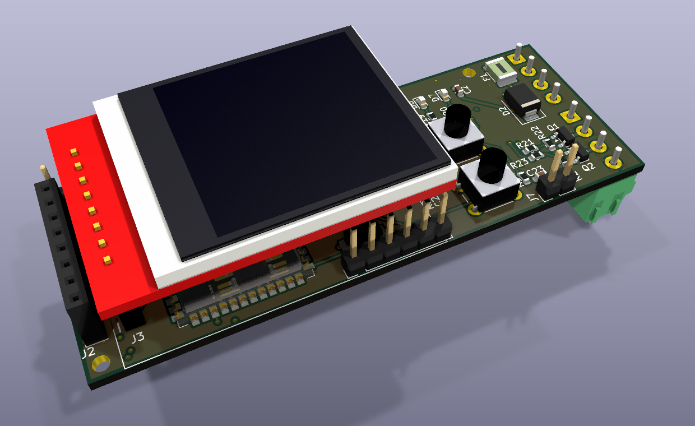

# D.CANCAN — DPF-Monitor und Datenlogger für VAG-Dieselmotoren (ESP32-S3)

[English](README.md) · [Українська](README.uk.md) · **Deutsch**

D.CANCAN ist eine kleine Platine für den OBD-II-Diagnose-CAN-Bus des Fahrzeugs. Sie liest die
Daten des Dieselpartikelfilters (DPF) aus dem Motorsteuergerät und speichert sie in ihrem eigenen Flash-Speicher.
Sie zeigt die Rußbeladung und weitere Daten auf einem 1,44"- oder 1,54"-Display an, warnt vor einer
Regeneration, erkennt, wann eine Regeneration läuft und wie sie endet, und verbindet sich per Bluetooth LE
mit einem Android-Telefon.



> ## ⚠ Nur an einem Škoda Octavia A7 2.0 TDI (EA288) getestet
> Die Firmware wurde bisher **nur an einem Škoda Octavia A7 2.0 TDI (Motor EA288)** entwickelt und getestet.
> Andere Fahrzeuge des VAG-Konzerns (VW, Audi, Seat, Škoda mit EA288 / EA189 u. a.) können andere
> Diagnoseadressen, Datenkennungen oder Regenerationsschwellen haben. **Tests an anderen Modellen sind nötig.**
> Wenn Sie D.CANCAN an einem anderen Fahrzeug ausprobieren, teilen Sie das Ergebnis bitte unter
> [Issues](../../issues) mit. Logs, Fragen und Vorschläge sind ebenfalls willkommen. Der Autor freut sich
> auf Ihre Rückmeldungen.

---

## Inhalt

1. [Funktionen](#funktionen)
2. [Paketinhalt](#paketinhalt)
3. [Hardware (Platine v3)](#hardware-platine-v3)
4. [Firmware 3.2](#firmware-32)
5. [Displaysprache](#displaysprache)
6. [Flashen](#flashen)
7. [Android-App](#android-app)
8. [Erste Inbetriebnahme](#erste-inbetriebnahme)
9. [Konsolenbefehle](#konsolenbefehle)
10. [Kompatibilität und Tests](#kompatibilität-und-tests)
11. [Sicherheit und Haftungsausschluss](#sicherheit-und-haftungsausschluss)
12. [Rückmeldungen](#rückmeldungen)

---

## Funktionen

- **Liest DPF-Daten** aus dem Motorsteuergerät (UDS / OBD-II über CAN 500 kbit/s): berechnete und gemessene
  Rußmasse, Ölasche, DPF-Eingangs- / Ausgangstemperatur, Strecke und Zeit seit der letzten Regeneration.
  Dazu 13 Standard-OBD-II-Werte (Drehzahl, Kühlmittel, Geschwindigkeit, Last, Spannung u. a.)
  und den Kilometerstand aus dem Kombiinstrument: **22 Parameter alle 2 s**.
- **Speichert alles im Flash** (Ringpuffer ≈10 MB): die Rohantworten jedes Abfragezyklus sowie
  Ereignisse (Zündung, Regenerationsbeginn / -ende, Fehlercodes, Telefon, Position). Die Dekodierung
  erfolgt am PC, sodass eine falsche Formel später ohne Datenverlust korrigiert werden kann.
- **Erkennt Regenerationen** (Beginn, Ende, abgebrochen, „Regeneration ausstehend“) und schätzt die Strecke bis zur
  nächsten anhand des Rußanstiegs.
- **Warnt den Fahrer**: drei LEDs (grün = Fahrzeug online, gelb = Regeneration bald,
  rot = Regeneration aktiv / abgebrochen) und zwei Low-Side-Ausgänge (OUT1 / OUT2) für Summer, Lampe oder Relais.
  Modi: `off`, `soon`, `active`, `beep`.
- **Display**: „klassischer“ Bildschirm (Ruß, DPF-Temperaturen, Strecke seit Regeneration, Asche, Spannung) und,
  bei verbundenem Telefon, ein Fahrbildschirm (Ort, Tempolimit-Schild, aktuelle Geschwindigkeit farbig, Straße,
  Kilometerstand, Fahrzeit und -strecke, DPF-Balken mit „km bis zur Regeneration“).
- **Liest Fehlercodes und FIN** (OBD 03 / 07 / 0A und UDS 19 02 FF). Das Gerät **liest nur**:
  Es löscht niemals Fehler und schreibt nichts in Steuergeräte.
- **Echtzeituhr** (RV-3028-C7 mit LR44- / SR44-Zelle): Zeitstempel im Log auch ohne Telefon.
- **Bluetooth-LE-Verbindung** zur Android-App D.CANCAN: Uhrzeit, Ort, Straße und Tempolimit werden an das Gerät übertragen.
  Regenerationsmeldungen erscheinen auf dem Telefon.
- **PC-Programm** (Python, USB-UART): lädt das Log herunter, zeigt es als Tabelle, exportiert CSV und stellt die Uhr.

## Paketinhalt

```
firmware/
  N16R8/   Firmware für ESP32-S3-WROOM-1-N16R8 (16 MB Flash, 8 MB Octal-PSRAM)
  N16R2/   Firmware für ESP32-S3-WROOM-1-N16R2 (16 MB Flash, 2 MB Quad-PSRAM)
           dcancan_fw3.2_<Modul>_full_0x0.bin  - komplettes Image, ab Adresse 0x0
           dcancan_fw3.2_app.bin               - nur Anwendung, Adresse 0x20000
           bootloader.bin, partition-table.bin, ota_data_initial.bin
  SHA256SUMS.txt
hardware/
  dcancan_v3_schematic.pdf   Schaltplan der Platine v3 (A3)
  3d/                        3D-Ansichten der Platine v3 (oben, unten, mit Display, isometrisch)
README.md, README.uk.md, README.de.md
```

**Welche Firmware?** Sehen Sie auf die Beschriftung der Metallabschirmung des ESP32-S3-Moduls. **N16R8** → Ordner
`N16R8`. **N16R2** → Ordner `N16R2`. Sie unterscheiden sich nur im PSRAM-Modus (Octal / Quad). Mit der
falschen Version läuft das Gerät trotzdem, aber ohne PSRAM (der Bildspeicher liegt dann im internen RAM).

## Hardware (Platine v3)

| Block | Bauteile |
|---|---|
| MCU | ESP32-S3-WROOM-1 (N16R8 oder N16R2), Leiterplattenantenne am Platinenrand |
| 12-V-Eingang | PTC-Sicherung 1,1 A (F1), Verpolschutzdiode SS34, TVS SMBJ18A, 100 µF / 35 V |
| 12 V → 5 V | synchroner Abwärtswandler TI TPS54202, 500 kHz, L 10 µH |
| 3,3 V | AP2112K-3.3 für die Logik + separater AP2112K für das Display |
| CAN | Transceiver SN65HVD230, ESD-Schutz PESD2CAN, 120-Ω-Abschluss nicht bestückt |
| Uhr | RV-3028-C7 (I²C 0x52), Pufferzelle LR44 / SR44 im Halter Keystone 2996 |
| Display | ST7735 1,44" 128×128 (J3, 8-poliges Modul) oder ST7789 1,54" 240×240 (J2); Display-VCC 5 V oder 3,3 V per Jumper JP1; PWM-Hintergrundbeleuchtung |
| Anzeige / Ausgänge | 3 LEDs, 2 MOSFET-Low-Side-Ausgänge (AO3400A) mit Freilaufdioden |
| Bedienung | 2 Taster (KEY1 = GPIO41, KEY2 = GPIO42, für ein Menü reserviert), externer Taster J7 (GPIO16) |
| Anschlüsse | J1 Klemme 3,5 mm: +12V, CAN-H, CAN-L, GND · J5 Klemme 3,5 mm: +12V, OUT1−, OUT2−, GND · J4 Programmer: +5V, TXD, RXD, IO0, EN, GND · J6 Reserve: 3V3, SDA, SCL, IO2, IO39, IO40, IO47, GND |
| Leiterplatte | 2 Lagen, 81 × 30 mm |

**OBD-II-Anschluss (J1):** +12V → OBD-Pin 16 (Dauerplus), CAN-H → Pin 6, CAN-L → Pin 14,
GND → Pins 4 / 5.

**Ausgänge (J5):** Last zwischen +12V (J5-1) und OUT1− / OUT2− anschließen. Der Gesamtstrom einschließlich
der Platine wird durch F1 (1,1 A) begrenzt: etwa 0,9 A für die Lasten.

Die Platine hat kein USB. Programmierung und serielle Konsole laufen über einen externen USB-UART-Adapter
(3,3-V-Logik) an J4. Der Adapter steuert IO0 und EN zum Flashen.

Schaltplan: `hardware/dcancan_v3_schematic.pdf`, 3D-Ansichten: `hardware/3d/`.

> Platine v3 ist die erste Revision dieses Layouts. Prüfen Sie Schaltplan und Footprints vor der Bestellung
> der Leiterplatten mit den gekauften Bauteilen.

## Firmware 3.2

- ESP-IDF 6.0, ESP32-S3, 16 MB Flash; zwei Builds (N16R8 / N16R2).
- Läuft auch auf der älteren Platine v2 (ESP32-S3-DevKitC-1 N16R8, gleiche GPIOs).
- **Neu in 3.2:** Displaysprache **Ukrainisch (Standard) / Englisch**, einstellbar in der App oder mit
  dem Befehl `lang`. Eigener Build für Module mit Quad-PSRAM (N16R2).
- 3.1: Unterstützung der Uhr RV-3028-C7 (DS3231 weiterhin unterstützt). 3.0: Bluetooth-Verbindung zum Telefon, Fahrbildschirm,
  zwei Displaytypen.

### Standardeinstellungen (Octavia A7 2.0 TDI)

| Einstellung | Wert | Befehl |
|---|---|---|
| Abfrageintervall | 2 s | `period <ms>` |
| Warnung „Regeneration bald“ | gemessener Ruß ≥ 20,0 g (dieses Steuergerät startet bei ≈ 21,9 g) | `warn soon <g>` |
| OUT1 / OUT2 | `active` / `soon` | `out <1\|2> <off\|soon\|active\|beep>` |
| Display | ST7735 128×128 | `disp panel 128\|240` |
| Displaysprache | Ukrainisch | `lang uk\|en` |

Die Rußschwellen stammen von diesem Fahrzeug. Bei anderen Motoren können sie abweichen — bitte im Log prüfen.

## Displaysprache

Das Gerätedisplay unterstützt **Ukrainisch (Standard)** und **Englisch**.

- **In der App:** *Sprache → Sprache des Gerätedisplays* → *Українська* / *English*. Die App überträgt die Auswahl
  bei jeder Verbindung an das Gerät. Das Gerät speichert sie, die Sprache bleibt also auch nach dem Ausschalten erhalten.
- **Ohne App:** Konsolenbefehl `lang en` oder `lang uk`.

Orts- und Straßennamen kommen vom Kartendienst. Ist Englisch eingestellt, fragt die App bei TomTom
englische Namen an.

Hinweis: Die App selbst ist auch auf Deutsch verfügbar. Auf dem Gerätedisplay gibt es derzeit nur Ukrainisch und Englisch.

## Flashen

Benötigt: ein USB-UART-Adapter mit 3,3-V-Logik an J4 (TXD↔RXD gekreuzt, IO0 und EN vom Adapter gesteuert
oder manuell: IO0 auf GND, dann EN kurz pulsen) und [esptool](https://github.com/espressif/esptool)
(`pip install esptool`).

**Erstinstallation** (komplettes Image):

```
esptool --chip esp32s3 -p COM5 -b 460800 write_flash 0x0 dcancan_fw3.2_N16R8_full_0x0.bin
```

**Update** (Einstellungen und gekoppelte Telefone bleiben erhalten):

```
esptool --chip esp32s3 -p COM5 -b 460800 write_flash 0x20000 dcancan_fw3.2_app.bin
```

`COM5` durch Ihren Port ersetzen (Linux: `/dev/ttyUSB0`), bei Bedarf `N16R8` durch `N16R2`.
Das komplette Image überschreibt auch den Einstellungsbereich (NVS), Einstellungen und Kopplungen werden also zurückgesetzt.
Das Datenlog liegt in einer eigenen Partition und wird bei **keiner** der beiden Methoden gelöscht. Zum Löschen dient der Befehl `erase CONFIRM`.

Alternativ funktioniert der Espressif-Web-Flasher (esptool-js) in Chrome / Edge mit denselben Dateien und Adressen.

Prüfsummen: `firmware/SHA256SUMS.txt`.

## Android-App

Die App D.CANCAN (Android 8.0+) läuft im Hintergrund und kommuniziert per Bluetooth LE mit dem Gerät:

- überträgt Uhrzeit, Ort, Straße und Tempolimit an das Gerät. Das Limit stammt von TomTom (Verkehrszeichendaten,
  kostenloser Schlüssel auf developer.tomtom.com), sonst von OpenStreetMap, sonst aus einer Faustregel (50 innerorts / 90 / 110 / 130,
  nach der ukrainischen StVO — kann in Ihrem Land abweichen);
- zeigt Regenerationsmeldungen an;
- **App-Sprachen: Ukrainisch, Englisch, Deutsch.** Standardmäßig folgt die App der Telefonsprache
  (andere → Englisch). Umstellen unter *Sprache → App-Sprache*;
- stellt die Sprache des Gerätedisplays ein (siehe oben).

Erste Kopplung: den Dienst in der Nähe des Fahrzeugs bei eingeschalteter Zündung starten. Das Gerät zeigt einen
6-stelligen Code, der im Android-Kopplungsdialog eingegeben wird.

## Erste Inbetriebnahme

1. Jumper JP1 passend zum Display setzen (5 V oder 3,3 V, siehe Displaymodul). LR44- / SR44-Zelle einsetzen.
2. Vor dem Anschluss ans Fahrzeug die Platine an einem Labornetzteil mit 12 V und Strombegrenzung (~0,2 A)
   versorgen: 5 V und 3,3 V müssen anliegen.
3. Firmware flashen (siehe oben), serielle Konsole öffnen (115200 Baud) und `info` ausführen.
4. Für das 240×240-Display: `disp panel 240`, danach `restart`.
5. J1 an die OBD-II-Buchse anschließen und die Zündung einschalten. Die grüne LED zeigt, dass das Fahrzeug antwortet.
6. Optional: App installieren und das Telefon koppeln.

## Konsolenbefehle

Serielle Konsole (115200 Baud, Prompt `dcancan>`). Die wichtigsten Befehle:

| Befehl | Zweck |
|---|---|
| `info` / `stat` | Status, Einstellungen, Log-Belegung |
| `read` | alle Parameter einmal lesen |
| `dtc` | Fehlercodes lesen (löscht sie nie) |
| `ident` / `vin` | FIN und Steuergeräte- / Softwarenummern |
| `warn [soon <g>]` | Zustand / Schwelle der Regenerationswarnung |
| `out <1\|2> <Modus>` | was die Ausgänge signalisieren |
| `disp ...` | Displayeinstellungen (`panel`, `rotate`, `invert`, `bgr`, `offset`, `test`) |
| `lang [uk\|en]` | Displaysprache |
| `ui [auto\|drive\|classic]` | Bildschirmauswahl |
| `rtc`, `time` | Uhr |
| `ble [forget]` | Telefonverbindung / gekoppelte Telefone löschen |
| `trip [reset]` | Fahrstrecke und -zeit |
| `period`, `echo`, `flushsec`, `flush` | Aufzeichnung |
| `dump`, `erase CONFIRM` | Log-Download (PC-Programm) / Log löschen |
| `scan`, `rescan`, `probe`, `sniff` | Untersuchung anderer Steuergeräte, nur lesend |

## Kompatibilität und Tests

| Fahrzeug | Status |
|---|---|
| Škoda Octavia A7 2.0 TDI (EA288) | ✅ an diesem Fahrzeug entwickelt und getestet |
| Andere VAG-Diesel mit DPF (EA288, EA189, …) | ❓ **nicht getestet — Tests nötig** |

Was bei anderen Fahrzeugen abweichen kann: Diagnoseadressen (7E0/7E8, Kombiinstrument 714/77E), DID-Nummern der
DPF-Daten, Skalierung und die Rußmenge, bei der das Steuergerät eine Regeneration startet. Die Firmware enthält
dafür nur lesende Werkzeuge: `scan`, `rescan`, `probe` und `sniff`.

Wenn Sie D.CANCAN an einem anderen Fahrzeug getestet haben, eröffnen Sie bitte ein [Issue](../../issues) mit:
Modell, Baujahr, Motorkennbuchstaben, Ausgabe von `ident` und `info` und wenn möglich einer Logdatei.

## Sicherheit und Haftungsausschluss

- Das Gerät **liest** nur Diagnosedaten. Es löscht keine Fehler, ändert keine Codierung und startet keine Regeneration.
- Montieren Sie es so, dass es während der Fahrt nicht ablenkt. Die Anzeigen dienen nur zur Information.
- Die Platine wird über OBD-Pin 16 (Dauerplus) versorgt. Steht das Fahrzeug längere Zeit,
  trennen Sie das Gerät.
- Tempolimits aus Kartendiensten können falsch oder veraltet sein. Es gelten immer die tatsächlichen Verkehrszeichen.
- Dies ist ein Hobbyprojekt ohne Verbindung zu Škoda, der Volkswagen AG oder anderen Herstellern.
  Die Nutzung erfolgt auf eigene Gefahr.

## Rückmeldungen

Der Autor freut sich über Rückmeldungen, Fragen und Testergebnisse von anderen Fahrzeugen. Bitte nutzen Sie
[Issues](../../issues) (Fehler, Testberichte) oder [Discussions](../../discussions) (Fragen, Ideen).
