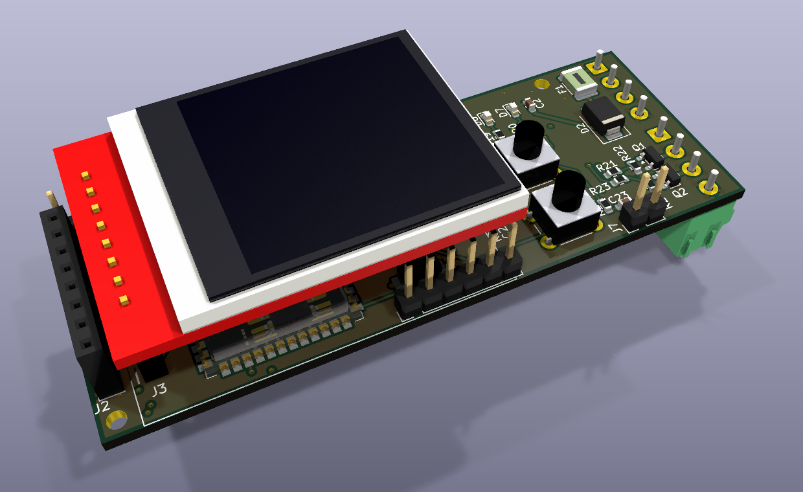

# D.CANCAN — DPF monitor and logger for VAG diesels (ESP32-S3)

**English** · [Українська](README.uk.md) · [Deutsch](README.de.md)

D.CANCAN is a small board that plugs into the OBD-II diagnostic CAN bus of a car. It reads the
diesel particulate filter (DPF) data from the engine ECU and stores it in its own flash memory.
It shows the soot load and other data on a 1.44" or 1.54" display, warns before a regeneration,
detects when a regeneration runs and how it ends, and links to an Android phone over Bluetooth LE.



> ## ⚠ Tested only on a Škoda Octavia A7 2.0 TDI (EA288)
> The firmware has so far been developed and tested **only on a Škoda Octavia A7 2.0 TDI (EA288 engine)**.
> Other VAG cars (VW, Audi, Seat, Škoda with EA288 / EA189 and others) may use different
> diagnostic addresses, data identifiers or regeneration thresholds. **Testing on other models is needed.**
> If you try D.CANCAN on another car, please share the result in
> [Issues](../../issues). Logs, questions and suggestions are welcome too. The author is waiting
> for your feedback.

---

## Contents

1. [What it does](#what-it-does)
2. [Package contents](#package-contents)
3. [Hardware (board v3)](#hardware-board-v3)
4. [Firmware 3.2](#firmware-32)
5. [Screen language](#screen-language)
6. [Flashing](#flashing)
7. [Android app](#android-app)
8. [First start](#first-start)
9. [Console commands](#console-commands)
10. [Compatibility and testing](#compatibility-and-testing)
11. [Safety and disclaimer](#safety-and-disclaimer)
12. [Feedback](#feedback)

---

## What it does

- **Reads DPF data** from the engine ECU (UDS / OBD-II on CAN 500 kbit/s): calculated and measured soot
  mass, oil ash, DPF inlet / outlet temperature, distance and time since the last regeneration.
  It also reads 13 standard OBD-II values (RPM, coolant, speed, load, voltage and others)
  and the odometer from the instrument cluster: **22 parameters every 2 s**.
- **Logs everything into flash** (≈10 MB ring buffer): the raw answers of every poll cycle plus
  events (ignition, regeneration start / end, fault codes, phone, position). Decoding is done
  on the PC, so a wrong formula can be fixed later without losing data.
- **Detects regenerations** (start, end, interrupted, "regen pending") and forecasts the distance to the
  next one from the soot trend.
- **Warns the driver**: three LEDs (green = car online, yellow = regeneration soon,
  red = regeneration active / interrupted) and two low-side outputs (OUT1 / OUT2) for a buzzer, lamp or relay.
  Modes: `off`, `soon`, `active`, `beep`.
- **Display**: a "classic" screen (soot, DPF temperatures, distance since regeneration, ash, voltage) and,
  with a phone connected, a "drive" screen (town, speed-limit sign, current speed in colour, street,
  odometer, trip time and distance, DPF bar with "km to regeneration").
- **Reads fault codes and VIN** (OBD 03 / 07 / 0A and UDS 19 02 FF). The device is **read-only**:
  it never clears faults and never writes to control units.
- **Real-time clock** (RV-3028-C7 with an LR44 / SR44 cell): log time stamps even without a phone.
- **Bluetooth LE link** to the D.CANCAN Android app: clock, town, street and speed limit go to the device.
  Regeneration notifications appear on the phone.
- **PC tool** (Python, USB-UART): downloads the log, shows it as a table, exports CSV and sets the clock.

## Package contents

```
firmware/
  N16R8/   firmware for ESP32-S3-WROOM-1-N16R8 (16 MB flash, 8 MB octal PSRAM)
  N16R2/   firmware for ESP32-S3-WROOM-1-N16R2 (16 MB flash, 2 MB quad PSRAM)
           dcancan_fw3.2_<module>_full_0x0.bin  - complete image, write at 0x0
           dcancan_fw3.2_app.bin                - application only, write at 0x20000
           bootloader.bin, partition-table.bin, ota_data_initial.bin
  SHA256SUMS.txt
app/
  DCANCAN_v0.2.0.apk         Android app (Android 8.0+), Ukrainian / English / German
  SHA256SUMS.txt
hardware/
  dcancan_v3_schematic.pdf   schematic of board v3 (A3)
  3d/                        3D views of board v3 (top, bottom, with display, isometric)
README.md, README.uk.md, README.de.md
```

**Which firmware?** Look at the label on the metal shield of the ESP32-S3 module. **N16R8** → folder
`N16R8`. **N16R2** → folder `N16R2`. They differ only in the PSRAM mode (octal / quad). With the
wrong one the device still works, but without PSRAM (the screen frame buffer then uses internal RAM).

## Hardware (board v3)

| Block | Parts |
|---|---|
| MCU | ESP32-S3-WROOM-1 (N16R8 or N16R2), PCB antenna at the board edge |
| 12 V input | PTC fuse 1.1 A (F1), reverse-polarity diode SS34, TVS SMBJ18A, 100 µF / 35 V |
| 12 V → 5 V | TI TPS54202 synchronous buck, 500 kHz, L 10 µH |
| 3.3 V | AP2112K-3.3 for the logic + a separate AP2112K for the display |
| CAN | SN65HVD230 transceiver, PESD2CAN ESD protection, 120 Ω terminator not fitted |
| Clock | RV-3028-C7 (I²C 0x52), backup cell LR44 / SR44 in a Keystone 2996 holder |
| Display | ST7735 1.44" 128×128 (J3, 8-pin module) or ST7789 1.54" 240×240 (J2); display VCC 5 V or 3.3 V with jumper JP1; PWM backlight |
| Indication / outputs | 3 LEDs, 2 MOSFET low-side outputs (AO3400A) with flyback diodes |
| Controls | 2 buttons (KEY1 = GPIO41, KEY2 = GPIO42, reserved for a menu), external button J7 (GPIO16) |
| Connectors | J1 3.5 mm terminal: +12V, CAN-H, CAN-L, GND · J5 3.5 mm terminal: +12V, OUT1−, OUT2−, GND · J4 programmer: +5V, TXD, RXD, IO0, EN, GND · J6 spare: 3V3, SDA, SCL, IO2, IO39, IO40, IO47, GND |
| PCB | 2 layers, 81 × 30 mm |

**OBD-II connection (J1):** +12V → OBD pin 16 (permanent +12 V), CAN-H → pin 6, CAN-L → pin 14,
GND → pins 4 / 5.

**Outputs (J5):** connect the load between +12V (J5-1) and OUT1− / OUT2−. The total current is limited
by F1 (1.1 A) to about 0.9 A, which includes the board itself.

There is no USB on the board. Programming and the serial console use an external USB-UART adapter
(3.3 V logic) on J4. The adapter switches IO0 and EN for flashing.

The schematic is in `hardware/dcancan_v3_schematic.pdf`. 3D views are in `hardware/3d/`.

> Board v3 is the first revision of this layout. Check the schematic and the footprints against the
> parts you buy before ordering PCBs.

## Firmware 3.2

- ESP-IDF 6.0, ESP32-S3, 16 MB flash; two builds (N16R8 / N16R2).
- Also runs on the older board v2 (ESP32-S3-DevKitC-1 N16R8, same GPIOs).
- **New in 3.2:** screen language **Ukrainian (default) / English**, set from the phone app or with
  the `lang` command. Separate build for modules with quad PSRAM (N16R2).
- 3.1: RV-3028-C7 clock support (DS3231 is still supported). 3.0: Bluetooth link to the phone, drive screen,
  two display types.

### Default settings (Octavia A7 2.0 TDI)

| Setting | Value | Command |
|---|---|---|
| Poll period | 2 s | `period <ms>` |
| "Regeneration soon" warning | measured soot ≥ 20.0 g (this ECU starts a regen at ≈ 21.9 g) | `warn soon <g>` |
| OUT1 / OUT2 | `active` / `soon` | `out <1\|2> <off\|soon\|active\|beep>` |
| Display | ST7735 128×128 | `disp panel 128\|240` |
| Screen language | Ukrainian | `lang uk\|en` |

The soot thresholds are taken from this car. On other engines they can be different, so check them in the log.

## Screen language

The device screen supports **Ukrainian (default)** and **English**.

- **In the app:** *Language → Device screen language* → *Українська* / *English*. The app sends the choice
  to the device every time it connects. The device saves it, so the language stays after a power-off.
- **Without the app:** serial console command `lang en` or `lang uk`.

City and street names come from the map service. With English selected, the app asks TomTom for
English names.

## Flashing

You need: a USB-UART adapter with 3.3 V logic on J4 (TXD↔RXD crossed, IO0 and EN controlled by the
adapter or pulled manually: IO0 to GND, then pulse EN) and [esptool](https://github.com/espressif/esptool)
(`pip install esptool`).

**First installation** (complete image):

```
esptool --chip esp32s3 -p COM5 -b 460800 write_flash 0x0 dcancan_fw3.2_N16R8_full_0x0.bin
```

**Update** (keeps settings and paired phones):

```
esptool --chip esp32s3 -p COM5 -b 460800 write_flash 0x20000 dcancan_fw3.2_app.bin
```

Replace `COM5` with your port (Linux: `/dev/ttyUSB0`) and `N16R8` with `N16R2` if needed.
The complete image also overwrites the settings area (NVS), so the settings and phone pairings return to their defaults.
The data log is in a separate partition and is **not erased** by either method. To delete the log, use the `erase CONFIRM` command.

You can also use the Espressif web flasher (esptool-js) in Chrome / Edge. Use the same files and addresses.

Check the files against `firmware/SHA256SUMS.txt`.

## Android app

`app/DCANCAN_v0.2.0.apk` — the D.CANCAN app for Android 8.0 and newer (about 100 KB, no ads, no account).
It runs in the background and talks to the device over Bluetooth LE.

**What it does**

- Sends the time, town, street and speed limit to the device (for the "drive" screen).
  The speed limit comes from:
  1. TomTom (road-sign data). This needs a free key, see below.
  2. OpenStreetMap, if there is no key or TomTom has no data.
  3. A rule of thumb if neither has a value: 50 km/h in towns, 90 outside, 110 / 130 on highways.
     This follows the Ukrainian traffic rules and may differ in your country.
- Shows the device data: soot, distance since regeneration, km to the next one, odometer, voltage, trip.
- Shows notifications: *DPF regeneration soon*, *DPF regeneration in progress*, *regeneration interrupted / finished*
  and *Time for a break* after 2 h of driving.
- **Languages: Ukrainian, English, German.** By default the app follows the phone language
  (any other language → English).
- Sets the language of the device screen (Ukrainian / English).

### Installation

The app is not in Google Play. Install the APK file directly:

1. Copy `DCANCAN_v0.2.0.apk` to the phone (USB cable, cloud drive, messenger) and open it.
2. Android asks to allow *Install unknown apps* for the app you opened it from (file manager, browser,
   messenger). Allow it and tap **Install**.
3. If Google Play Protect warns about an unknown developer, tap *More details → Install anyway*.
   The APK is signed by the author's own key, not by Google.

Alternatively, with *USB debugging* enabled on the phone: `adb install -r DCANCAN_v0.2.0.apk`.

**Updating:** install the new APK over the old one. Settings and the pairing stay.

### First setup

Open **D.CANCAN** and go from top to bottom:

1. **Grant permissions**: *Nearby devices* (Bluetooth), *Location* and *Notifications*.
2. **"Location: allow all the time" (for background)**: in the system settings choose *Allow all the time*.
   Without it the speed limit is not updated while the screen is off.
3. **Don't restrict background work (battery)**: choose *Allow*. Otherwise Android may stop the service.
   Some phones (Xiaomi, Huawei, Samsung…) also have their own "battery saver" or "autostart" lists. Allow D.CANCAN there too.
4. **TomTom key** (optional, recommended): tap **Get a free TomTom key**, register at developer.tomtom.com and
   copy the default key from *Keys*. Paste it and tap **Save key**. The free plan needs no credit card and
   is enough for daily driving: the app asks at most every ~80 m / 10 s of driving.
5. **Language**: *App language* (System / Українська / English / Deutsch) and *Device screen language*
   (Українська / English).
6. Tap **Start service**, standing near the car with the ignition on.
   The phone finds `D.CANCAN-XXXX` and the device screen shows a **6-digit code**. Enter it in the Android
   pairing dialog.

After this you do not need to open the app. The service starts with the phone, connects whenever the device is
in range, and keeps a small permanent "D.CANCAN" notification (Android requires it for background services).

### Screens of the app

| Card | Content |
|---|---|
| **Status** | service state, device address, permissions |
| **Device** | firmware version, ignition / engine, speed, soot, regeneration, odometer, coolant, battery, trip |
| **Navigation** | town, street, speed limit and its source |
| **Log** | the last connection events (useful for bug reports) |

Buttons: **Start service / Stop service**, **Find the device again** (forget the saved device and search anew).

### Troubleshooting

| Problem | What to do |
|---|---|
| Device not found | Ignition on, phone within a few metres, Bluetooth on. Tap **Find the device again**. |
| Wrong code / pairing failed | In Android Bluetooth settings remove `D.CANCAN-XXXX`. On the device run `ble forget` (deletes all paired phones). Then search again. |
| No speed limit when the screen is off | Location permission must be *Allow all the time*. Battery optimisation must be off. |
| Device screen stays in Ukrainian | Firmware 3.2 or newer is needed. The language is sent when the phone connects. |
| Limit is "by traffic rules" only | No TomTom key, or TomTom / OpenStreetMap have no data for this road. |

**Privacy:** the app sends your position only to TomTom (if you entered a key) and to the OpenStreetMap
Overpass API to get the speed limit. Nothing else leaves the phone. There is no account and no analytics.

## First start

1. Fit the jumper JP1 for your display (5 V or 3.3 V, see the display module). Insert the LR44 / SR44 cell.
2. Before connecting to the car, power the board from a 12 V lab supply with a current limit
   (~0.2 A): the 5 V and 3.3 V rails must be present.
3. Flash the firmware (see above), then open the serial console (115200 baud) and run `info`.
4. If you use the 240×240 display: `disp panel 240`, then `restart`.
5. Connect J1 to the OBD-II socket and switch the ignition on. The green LED shows that the car answers.
6. Optional: install the app and pair the phone.

## Console commands

Serial console (115200 baud, prompt `dcancan>`). Main commands:

| Command | Purpose |
|---|---|
| `info` / `stat` | status, settings, log usage |
| `read` | read all parameters once |
| `dtc` | read fault codes (never clears them) |
| `ident` / `vin` | VIN and ECU / software numbers |
| `warn [soon <g>]` | regeneration warning state / threshold |
| `out <1\|2> <mode>` | what the outputs signal |
| `disp ...` | display settings (`panel`, `rotate`, `invert`, `bgr`, `offset`, `test`) |
| `lang [uk\|en]` | screen language |
| `ui [auto\|drive\|classic]` | screen choice |
| `rtc`, `time` | clock |
| `ble [forget]` | phone link / delete paired phones |
| `trip [reset]` | trip distance and time |
| `period`, `echo`, `flushsec`, `flush` | logging |
| `dump`, `erase CONFIRM` | log download (PC tool) / delete the log |
| `scan`, `rescan`, `probe`, `sniff` | read-only research of other control units |

## Compatibility and testing

| Car | Status |
|---|---|
| Škoda Octavia A7 2.0 TDI (EA288) | ✅ developed and tested on this car |
| Other VAG diesels with DPF (EA288, EA189, …) | ❓ **not tested — testing needed** |

What can differ on other cars: diagnostic addresses (7E0/7E8, cluster 714/77E), DID numbers of the DPF
data, scaling, and the soot level at which the ECU starts a regeneration. The firmware has research tools
for this: `scan`, `rescan`, `probe` and `sniff`. They are read-only.

If you test D.CANCAN on another car, please open an [Issue](../../issues) with:
the car model, year, engine code, the output of `ident` and `info`, and if possible a log file.

## Safety and disclaimer

- The device only **reads** diagnostic data. It does not clear faults, change coding or start regenerations.
- Mount it so that it does not distract you while driving. The data on the screen is for information only.
- The board is powered from OBD pin 16 (permanent +12 V). If the car stands unused for a long time,
  unplug the device.
- Speed limits from map services can be wrong or out of date. Always follow the real road signs.
- This is a hobby project. It is not affiliated with Škoda, Volkswagen AG or other manufacturers.
  You use it at your own risk.

## Feedback

The author welcomes feedback, questions and test results from other cars. Please use
[Issues](../../issues) (bugs, test reports) or [Discussions](../../discussions) (questions, ideas).
