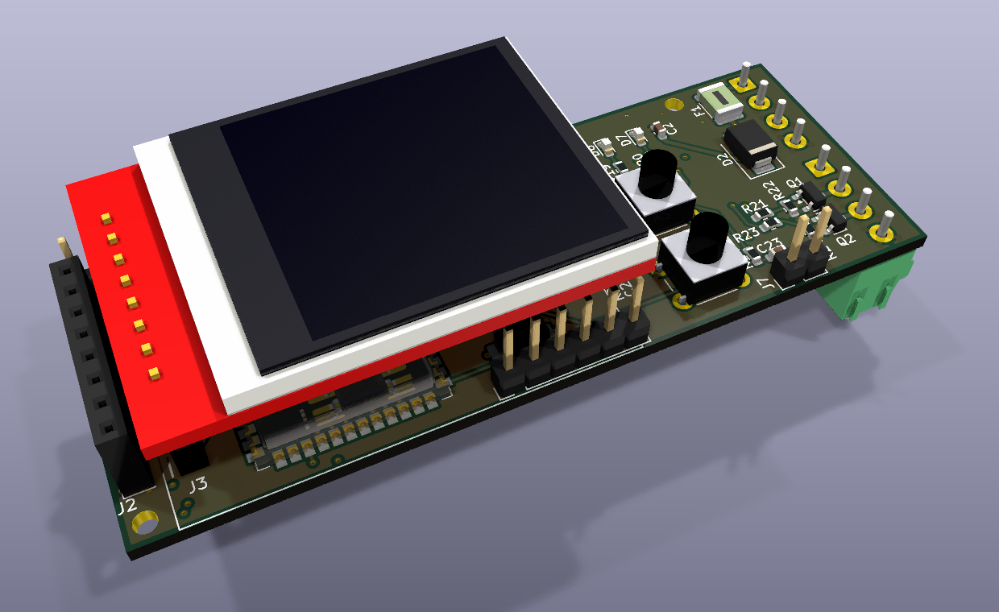

# D.CANCAN — монітор і логер сажового фільтра для дизелів VAG (ESP32-S3)

[English](README.md) · **Українська** · [Deutsch](README.de.md)

D.CANCAN — невелика плата, яка підключається до діагностичної шини CAN автомобіля (OBD-II).
Вона зчитує з блока керування двигуном дані сажового фільтра (DPF) і зберігає їх у власній флеш-пам'яті.
Прилад показує заповнення фільтра й інші дані на дисплеї 1,44" або 1,54", попереджає про
наближення регенерації, визначає, коли вона йде і як закінчилась, і з'єднується з Android-телефоном через Bluetooth LE.



> ## ⚠ Перевірено лише на Škoda Octavia A7 2.0 TDI (EA288)
> Прошивку розроблено й перевірено **тільки на Škoda Octavia A7 2.0 TDI (двигун EA288)**.
> Інші автомобілі концерну VAG (VW, Audi, Seat, Škoda з EA288 / EA189 тощо) можуть мати інші
> діагностичні адреси, ідентифікатори даних або пороги регенерації. **Потрібне тестування на інших моделях.**
> Якщо ви спробуєте D.CANCAN на іншому авто, поділіться, будь ласка, результатом в
> [Issues](../../issues). Також чекаю на логи, запитання й пропозиції. Автор чекає ваших відгуків.

---

## Зміст

1. [Що вміє](#що-вміє)
2. [Склад пакета](#склад-пакета)
3. [Апаратна частина (плата v3)](#апаратна-частина-плата-v3)
4. [Прошивка 3.2](#прошивка-32)
5. [Мова дисплея](#мова-дисплея)
6. [Прошивання](#прошивання)
7. [Android-додаток](#android-додаток)
8. [Перше ввімкнення](#перше-ввімкнення)
9. [Команди консолі](#команди-консолі)
10. [Сумісність і тестування](#сумісність-і-тестування)
11. [Безпека й застереження](#безпека-й-застереження)
12. [Зворотний зв'язок](#зворотний-звязок)

---

## Що вміє

- **Зчитує дані DPF** з блока керування двигуном (UDS / OBD-II по CAN 500 кбіт/с): розрахункову й виміряну масу
  сажі, масу оливного попелу, температуру на вході / виході фільтра, пробіг і час від останньої регенерації.
  Також читає 13 стандартних параметрів OBD-II (оберти, температура ОР, швидкість, навантаження, напруга тощо)
  і пробіг з панелі приладів: **22 параметри кожні 2 с**.
- **Записує все у флеш-пам'ять** (кільцевий журнал ≈10 МБ): сирі відповіді кожного циклу опитування та
  події (запалювання, початок / кінець регенерації, коди несправностей, телефон, координати). Розшифровка
  робиться на ПК, тож помилку у формулі можна виправити пізніше без втрати даних.
- **Визначає регенерації** (початок, завершення, перервана, «регенерація очікується») і прогнозує пробіг до
  наступної за швидкістю накопичення сажі.
- **Попереджає водія**: три світлодіоди (зелений — авто на зв'язку, жовтий — скоро регенерація,
  червоний — регенерація йде / перервана) і два виходи з відкритим стоком (OUT1 / OUT2) для зумера, лампи чи реле.
  Режими: `off`, `soon`, `active`, `beep`.
- **Дисплей**: «класичний» екран (сажа, температури DPF, пробіг від регенерації, попіл, напруга) та,
  коли під'єднано телефон, екран «у дорозі» (місто, знак обмеження швидкості, поточна швидкість кольором,
  вулиця, одометр, час і пробіг поїздки, шкала DPF з «км до регенерації»).
- **Читає коди несправностей і VIN** (OBD 03 / 07 / 0A і UDS 19 02 FF). Прилад **лише читає**:
  ніколи не стирає помилки й нічого не записує в блоки керування.
- **Годинник реального часу** (RV-3028-C7 з елементом LR44 / SR44): позначки часу в журналі навіть без телефона.
- **Зв'язок Bluetooth LE** з Android-додатком D.CANCAN: телефон передає приладу годинник, місто, вулицю
  й обмеження швидкості. Сповіщення про регенерацію з'являються на телефоні.
- **Програма для ПК** (Python, USB-UART): завантажує журнал, показує його таблицею, експортує CSV і встановлює годинник.

## Склад пакета

```
firmware/
  N16R8/   прошивка для ESP32-S3-WROOM-1-N16R8 (16 МБ флеш, 8 МБ PSRAM, octal)
  N16R2/   прошивка для ESP32-S3-WROOM-1-N16R2 (16 МБ флеш, 2 МБ PSRAM, quad)
           dcancan_fw3.2_<модуль>_full_0x0.bin  - повний образ, записувати з адреси 0x0
           dcancan_fw3.2_app.bin                - лише програма, адреса 0x20000
           bootloader.bin, partition-table.bin, ota_data_initial.bin
  SHA256SUMS.txt
app/
  DCANCAN_v0.2.0.apk         Android-додаток (Android 8.0+), українська / англійська / німецька
  SHA256SUMS.txt
hardware/
  dcancan_v3_schematic.pdf   принципова схема плати v3 (A3)
  3d/                        3D-зображення плати v3 (зверху, знизу, з дисплеєм, ізометрія)
README.md, README.uk.md, README.de.md
```

**Яку прошивку брати?** Подивіться напис на металевому екрані модуля ESP32-S3. **N16R8** → папка
`N16R8`. **N16R2** → папка `N16R2`. Вони відрізняються лише режимом PSRAM (octal / quad). З «чужою»
прошивкою прилад теж працює, але без PSRAM (буфер екрана тоді у внутрішній пам'яті).

## Апаратна частина (плата v3)

| Блок | Елементи |
|---|---|
| Мікроконтролер | ESP32-S3-WROOM-1 (N16R8 або N16R2), антена на краю плати |
| Вхід 12 В | самовідновлюваний запобіжник 1,1 А (F1), діод від переплюсовки SS34, супресор SMBJ18A, 100 мкФ / 35 В |
| 12 В → 5 В | синхронний понижувальний перетворювач TI TPS54202, 500 кГц, дросель 10 мкГн |
| 3,3 В | AP2112K-3.3 для логіки + окремий AP2112K для дисплея |
| CAN | трансивер SN65HVD230, захист PESD2CAN, термінатор 120 Ом не встановлюється |
| Годинник | RV-3028-C7 (I²C 0x52), резервний елемент LR44 / SR44 у тримачі Keystone 2996 |
| Дисплей | ST7735 1,44" 128×128 (J3, 8-контактний модуль) або ST7789 1,54" 240×240 (J2); живлення дисплея 5 В або 3,3 В перемичкою JP1; підсвітка з ШІМ |
| Індикація / виходи | 3 світлодіоди, 2 виходи на MOSFET (AO3400A) з захисними діодами |
| Керування | 2 кнопки (KEY1 = GPIO41, KEY2 = GPIO42, зарезервовано для меню), зовнішня кнопка J7 (GPIO16) |
| Роз'єми | J1 клема 3,5 мм: +12V, CAN-H, CAN-L, GND · J5 клема 3,5 мм: +12V, OUT1−, OUT2−, GND · J4 програматор: +5V, TXD, RXD, IO0, EN, GND · J6 запасний: 3V3, SDA, SCL, IO2, IO39, IO40, IO47, GND |
| Друкована плата | 2 шари, 81 × 30 мм |

**Підключення до OBD-II (J1):** +12V → контакт 16 (постійні +12 В), CAN-H → 6, CAN-L → 14,
GND → 4 / 5.

**Виходи (J5):** навантаження вмикається між +12V (J5-1) і OUT1− / OUT2−. Загальний струм разом із
самою платою обмежує F1 (1,1 А): приблизно до 0,9 А на навантаження.

USB на платі немає. Прошивання й консоль — через зовнішній USB-UART адаптер (логіка 3,3 В)
на роз'ємі J4. Адаптер керує IO0 та EN під час прошивання.

Схема — `hardware/dcancan_v3_schematic.pdf`, 3D-зображення — `hardware/3d/`.

> Плата v3 — перша ревізія цієї розводки. Перед замовленням друкованих плат звірте схему й футпринти
> з компонентами, які купуєте.

## Прошивка 3.2

- ESP-IDF 6.0, ESP32-S3, флеш 16 МБ; дві збірки (N16R8 / N16R2).
- Працює й на попередній платі v2 (ESP32-S3-DevKitC-1 N16R8, ті самі GPIO).
- **Нове в 3.2:** мова дисплея — **українська (за замовчуванням) / англійська**, вибирається в
  додатку на телефоні або командою `lang`. Окрема збірка для модулів з PSRAM quad (N16R2).
- 3.1: підтримка годинника RV-3028-C7 (DS3231 теж підтримується). 3.0: зв'язок з телефоном, екран «у дорозі»,
  два типи дисплеїв.

### Налаштування за замовчуванням (Octavia A7 2.0 TDI)

| Параметр | Значення | Команда |
|---|---|---|
| Період опитування | 2 с | `period <мс>` |
| Попередження «скоро регенерація» | виміряна сажа ≥ 20,0 г (цей блок запускає регенерацію при ≈ 21,9 г) | `warn soon <г>` |
| OUT1 / OUT2 | `active` / `soon` | `out <1\|2> <off\|soon\|active\|beep>` |
| Дисплей | ST7735 128×128 | `disp panel 128\|240` |
| Мова дисплея | українська | `lang uk\|en` |

Пороги сажі взято з цього авто. На інших двигунах вони можуть бути іншими — перевірте їх за журналом.

## Мова дисплея

Дисплей приладу підтримує **українську (за замовчуванням)** та **англійську** мови.

- **У додатку:** *Мова → Мова дисплея приладу* → *Українська* / *English*. Додаток передає вибір приладу
  при кожному підключенні. Прилад його запам'ятовує, тож мова зберігається й після вимкнення живлення.
- **Без додатка:** команда консолі `lang en` або `lang uk`.

Назви міст і вулиць надходять із картографічного сервісу. Якщо вибрано англійську, додаток запитує
в TomTom англійські назви.

## Прошивання

Потрібно: USB-UART адаптер з логікою 3,3 В на J4 (TXD↔RXD навхрест, IO0 та EN керує адаптер, або
вручну: IO0 на GND, потім імпульс на EN) і [esptool](https://github.com/espressif/esptool)
(`pip install esptool`).

**Перше встановлення** (повний образ):

```
esptool --chip esp32s3 -p COM5 -b 460800 write_flash 0x0 dcancan_fw3.2_N16R8_full_0x0.bin
```

**Оновлення** (налаштування й спарені телефони зберігаються):

```
esptool --chip esp32s3 -p COM5 -b 460800 write_flash 0x20000 dcancan_fw3.2_app.bin
```

Замініть `COM5` своїм портом (Linux: `/dev/ttyUSB0`), а `N16R8` — на `N16R2`, якщо потрібно.
Повний образ перезаписує й область налаштувань (NVS), тож налаштування та спарені телефони скидаються.
Журнал даних лежить в окремому розділі й **не стирається** жодним способом. Видалити журнал можна командою `erase CONFIRM`.

Можна також скористатися веб-прошивальником Espressif (esptool-js) у Chrome / Edge з тими самими файлами й адресами.

Перевірити файли можна за `firmware/SHA256SUMS.txt`.

## Android-додаток

`app/DCANCAN_v0.2.0.apk` — додаток D.CANCAN для Android 8.0 і новіших (близько 100 КБ, без реклами й облікового запису).
Працює у фоні й зв'язується з приладом через Bluetooth LE.

**Що робить**

- Передає приладу час, місто, вулицю й обмеження швидкості (для екрана «у дорозі»).
  Обмеження береться:
  1. З TomTom (дані дорожніх знаків). Потрібен безкоштовний ключ, див. нижче.
  2. З OpenStreetMap, якщо ключа немає або в TomTom немає даних.
  3. За правилами, якщо значення немає ніде: 50 км/год у місті, 90 поза ним, 110 / 130 на трасах.
     Це відповідає ПДР України, в інших країнах може відрізнятися.
- Показує дані приладу: сажа, пробіг від регенерації, км до наступної, одометр, напруга, поїздка.
- Показує сповіщення: *Скоро регенерація сажового фільтра*, *Йде регенерація сажового фільтра*,
  *регенерацію перервано / завершено* та *Час відпочити* після 2 год за кермом.
- **Мови: українська, англійська, німецька.** За замовчуванням — мова телефона
  (для будь-якої іншої мови — англійська).
- Встановлює мову дисплея приладу (українська / англійська).

### Встановлення

Додатка немає в Google Play — APK-файл встановлюється напряму:

1. Скопіюйте `DCANCAN_v0.2.0.apk` на телефон (кабелем, через хмарний диск чи месенджер) і відкрийте його.
2. Android попросить дозволити *Встановлення невідомих додатків* для програми, з якої ви відкриваєте файл
   (файловий менеджер, браузер, месенджер). Дозвольте й натисніть **Встановити**.
3. Якщо Google Play Захист попередить про невідомого розробника: *Докладніше → Усе одно встановити*.
   APK підписано власним ключем автора, а не Google.

Інший спосіб — з увімкненим *Налагодженням USB* на телефоні: `adb install -r DCANCAN_v0.2.0.apk`.

**Оновлення:** встановіть новий APK поверх старого. Налаштування й спарювання зберігаються.

### Перше налаштування

Відкрийте **D.CANCAN** і пройдіть зверху вниз:

1. **Надати дозволи**: *Пристрої поблизу* (Bluetooth), *Геолокація* та *Сповіщення*.
2. **Дозвіл «Геолокація завжди» (для фону)**: у налаштуваннях системи виберіть *Дозволяти завжди*.
   Без цього обмеження швидкості не оновлюються, коли екран вимкнений.
3. **Не обмежувати роботу у фоні (батарея)**: виберіть *Дозволити*. Інакше Android може зупинити службу.
   На деяких телефонах (Xiaomi, Huawei, Samsung…) є ще власні списки «економії батареї» чи «автозапуску» — дозвольте D.CANCAN і там.
4. **Ключ TomTom** (необов'язково, але рекомендовано): **Отримати безкоштовний ключ TomTom**, зареєструйтеся на
   developer.tomtom.com і скопіюйте ключ за замовчуванням з розділу *Keys*. Вставте його й натисніть **Зберегти ключ**.
   Безкоштовного тарифу без банківської картки досить для щоденних поїздок: додаток запитує не частіше ніж раз на ~80 м / 10 с руху.
5. **Мова**: *Мова додатка* (Як у системі / Українська / English / Deutsch) і *Мова дисплея приладу*
   (Українська / English).
6. Біля авто з увімкненим запалюванням натисніть **Запустити службу**.
   Телефон знайде `D.CANCAN-XXXX`, а прилад покаже на дисплеї **6-значний код**. Введіть його у вікні
   спарювання Android.

Після цього відкривати додаток не потрібно. Служба запускається разом із телефоном, сама підключається, коли
прилад поруч, і тримає маленьке постійне сповіщення «D.CANCAN» (Android вимагає його для фонових служб).

### Вікно додатка

| Картка | Що показує |
|---|---|
| **Стан** | стан служби, адреса приладу, дозволи |
| **Прилад** | версія прошивки, запалювання / двигун, швидкість, сажа, регенерація, одометр, температура ОР, напруга, поїздка |
| **Навігація** | місто, вулиця, обмеження швидкості та його джерело |
| **Журнал** | останні події зв'язку (знадобиться для звіту про помилку) |

Кнопки: **Запустити / Зупинити службу**, **Знайти прилад заново** (забути збережений прилад і шукати знову).

### Якщо щось не працює

| Проблема | Що зробити |
|---|---|
| Прилад не знаходиться | Запалювання ввімкнене, телефон за кілька метрів, Bluetooth увімкнено. Натисніть **Знайти прилад заново**. |
| Невірний код / не спарюється | У налаштуваннях Bluetooth Android видаліть `D.CANCAN-XXXX`. На приладі виконайте `ble forget` (видаляє всі спарені телефони). Потім шукайте знову. |
| Немає обмеження швидкості, коли екран вимкнений | Дозвіл геолокації має бути *Дозволяти завжди*, оптимізацію батареї треба вимкнути. |
| Дисплей приладу лишається українською | Потрібна прошивка 3.2 або новіша. Мова передається при підключенні телефона. |
| Обмеження тільки «за ПДР» | Немає ключа TomTom, або в TomTom / OpenStreetMap немає даних для цієї дороги. |

**Приватність:** додаток надсилає ваші координати лише в TomTom (якщо введено ключ) та в OpenStreetMap
Overpass API, щоб отримати обмеження швидкості. Більше нічого з телефона не передається. Облікового запису й аналітики немає.

## Перше ввімкнення

1. Встановіть перемичку JP1 під свій дисплей (5 В або 3,3 В — див. модуль дисплея). Вставте елемент LR44 / SR44.
2. До підключення до авто подайте 12 В з лабораторного блока з обмеженням струму (~0,2 А):
   мають бути напруги 5 В і 3,3 В.
3. Прошийте прилад (див. вище), відкрийте консоль (115200 бод) і виконайте `info`.
4. Для дисплея 240×240: `disp panel 240`, потім `restart`.
5. Підключіть J1 до роз'єму OBD-II та ввімкніть запалювання. Зелений світлодіод означає, що авто відповідає.
6. За бажанням: встановіть додаток і спаріть телефон.

## Команди консолі

Послідовна консоль (115200 бод, запрошення `dcancan>`). Основні команди:

| Команда | Призначення |
|---|---|
| `info` / `stat` | стан, налаштування, заповнення журналу |
| `read` | одноразово прочитати всі параметри |
| `dtc` | прочитати коди несправностей (ніколи не стирає) |
| `ident` / `vin` | VIN і номери блоків / ПЗ |
| `warn [soon <г>]` | стан і поріг попередження про регенерацію |
| `out <1\|2> <режим>` | що сигналізують виходи |
| `disp ...` | налаштування дисплея (`panel`, `rotate`, `invert`, `bgr`, `offset`, `test`) |
| `lang [uk\|en]` | мова дисплея |
| `ui [auto\|drive\|classic]` | вибір екрана |
| `rtc`, `time` | годинник |
| `ble [forget]` | зв'язок з телефоном / видалити спарені телефони |
| `trip [reset]` | пробіг і час поїздки |
| `period`, `echo`, `flushsec`, `flush` | журналювання |
| `dump`, `erase CONFIRM` | вивантаження журналу (програма для ПК) / видалити журнал |
| `scan`, `rescan`, `probe`, `sniff` | дослідження інших блоків, лише читання |

## Сумісність і тестування

| Автомобіль | Стан |
|---|---|
| Škoda Octavia A7 2.0 TDI (EA288) | ✅ розроблено й перевірено на цьому авто |
| Інші дизелі VAG із DPF (EA288, EA189, …) | ❓ **не перевірено — потрібне тестування** |

Що може відрізнятися на інших авто: діагностичні адреси (7E0/7E8, панель приладів 714/77E), номери DID для
даних DPF, масштабування й рівень сажі, при якому блок запускає регенерацію. Для пошуку в прошивці є
інструменти лише для читання: `scan`, `rescan`, `probe` і `sniff`.

Якщо ви перевірили D.CANCAN на іншому авто, відкрийте, будь ласка, [Issue](../../issues) і вкажіть:
модель, рік, код двигуна, вивід команд `ident` та `info`, за можливості — файл журналу.

## Безпека й застереження

- Прилад лише **читає** діагностичні дані. Він не стирає помилки, не змінює кодування й не запускає регенерацію.
- Встановлюйте прилад так, щоб він не відволікав під час руху. Дані на дисплеї — довідкові.
- Плата живиться від контакту 16 OBD (постійні +12 В). Якщо авто довго стоїть без руху,
  від'єднайте прилад.
- Обмеження швидкості з картографічних сервісів можуть бути помилковими чи застарілими. Орієнтуйтеся на реальні знаки.
- Це аматорський проєкт, не пов'язаний зі Škoda, Volkswagen AG чи іншими виробниками.
  Ви використовуєте його на власний ризик.

## Зворотний зв'язок

Автор буде радий відгукам, запитанням і результатам перевірки на інших авто. Пишіть в
[Issues](../../issues) (помилки, звіти про тестування) або [Discussions](../../discussions) (запитання, ідеї).
